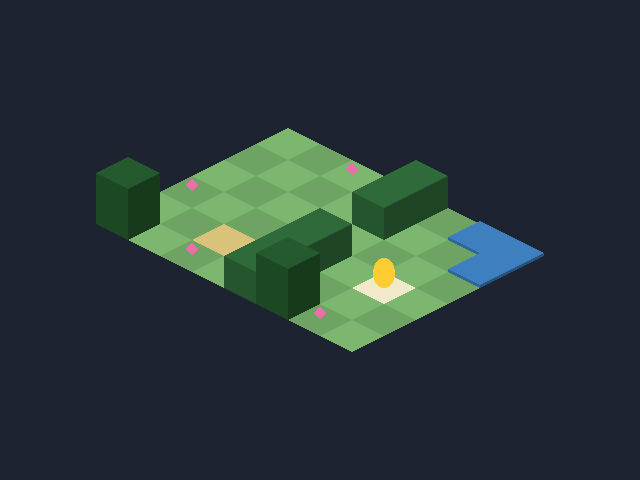

# Cold-agent test #1 — 2026-11-25

The direction doc's "test of the whole idea": *a coding agent starting cold, with only the AGENTS.md,
builds and verifies that scene without help.* Protocol: [mvp-plan.md](../mvp-plan.md#the-cold-agent-test).

## Setup

- slate v0.1.0, release build at commit `800556f`.
- A fresh general-purpose Claude agent (no conversation history), an empty folder outside the repo, the
  binary path, and the verbatim task from the protocol. It was told not to read any folder except its own
  and to use only files created by `slate new` and slate's own output.

## Result: PASS

| criterion | result |
|---|---|
| `slate check` clean | ✅ `check ok: 2 scene(s), 6 prefab(s), 3 playtest(s) — 0 error(s), 0 warning(s)` |
| `slate test` passes with an end-state `[[expect]]` and a `[[shot]]` | ✅ 3 passed; `garden_solve` has 5 expects and 2 shots |
| agent looked at the PNG | ✅ opened both references, plus a diff and an actual image |

- **Time:** 3 min 58 s · **tool calls:** 27 · **slate commands:** 32 · ~99K tokens.
- **Independently verified** by re-running `slate check` / `slate test` in the agent's folder and viewing
  the reference image: player on the goal tile, gate gap open, gem collected.
- **Original work**, not a copy of the AGENTS.md example: an 8×6 walled garden with a hedge along x = 4,
  a gate at (4, 2), a plate as a detour at (2, 4), a goal + gem built from a trigger with
  `only = "player"`, a pond, trees, flowers; a second, *negative* playtest proving the gate blocks without
  the plate. The files are archived in [cold-agent-1/](cold-agent-1/).
- **Errors hit:** no check errors and no failed expectations at any point — the first scene it wrote was
  valid. The only diagnostics were the expected E0403/E0402 around reference images.
- Consulted nothing beyond the generated files and slate's output.

## What confused it, and what changed

| # | finding (agent's words, shortened) | fix in the commit after this test |
|---|---|---|
| 1 | "E0402 hint points at the wrong frame": it suggested plain `slate shot --report`, which renders the main scene at frame 0 | image diagnostics now give the exact commands: `slate shot --input tests/X.toml --frame N --report` and `slate test --filter X --update-refs` |
| 2 | "There is no goal / win condition"; had to invent tile + trigger + `only` | new **Recipes** section in AGENTS.md: goal, plate-door (and re-closing), collectible, negative tests, tap buttons |
| 3 | "`entity` filter on `[[expect]] event` is ambiguous" (it matched the blocker too) | `entity` now matches the event's **subject** only (mover / trigger / emitter / target / hit entity), documented in the schema and AGENTS.md |
| 4 | "`blocked` mixes cooldown refusals with real blocks" | new `[[expect]] reason = "solid" \| "actor" \| "edge" \| "area" \| "cooldown"` filter (E0105 if used without `event = "blocked"`) |
| 5–6 | hold-during-cooldown behaviour and first-step timing only implied | mover docs and Tips state it exactly: moves on the first frame if ready, every `step_frames` while held, `for = step_frames × N` = N steps; presses during the wait are dropped, holds move when it ends |
| 7 | "Nothing warns about occlusion except `shot --report`": its goal tile was 60% hidden by a tree | new **W0304 hidden-trigger** (trigger tiles under 75% visible, ignoring what stands on the cell), and `slate test` now reports frame-report warnings for every `[[shot]]` |
| 8 | `--update-refs` doesn't list what it writes | it now prints `updated tests/refs/X.png (frame N)` per file |
| 9 | `slate help check` example names `examples/iso_garden`, which a new project lacks | example changed to `slate check my-game --json` |
| 10 | `slate explain` with no topic gives no list | it now lists every format/component, code and command |

Also fixed while verifying: diagnostics with a line but no column now print `file:line` (shot diagnostics
were printing only the file).

Not changed (already known): adjacent blocks of similar color merge visually (the agent's tree at (5, 5)
"reads as part of the hedge") — block outlines are on the roadmap.

## Next run

Repeat with the fixed build and a different task (e.g. "a level with two plates that must both be held")
to see whether the recipes cover it and whether new gaps appear.
