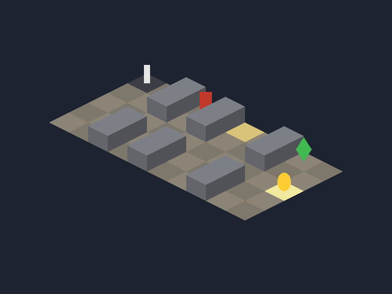

# Cold-agent test #2 — 2026-11-25

A harder task than [run #1](2026-11-25-cold-agent-1.md), on the build with run #1's fixes (`1277b8b`).
Same isolation: a fresh agent, the `slate` binary, an empty folder, nothing but files from `slate new` and
slate's own output.

## Task (verbatim)

> Run `slate new castle` and read castle/AGENTS.md. Build a level with: a guard that patrols back and forth
> across the player's path; a lever the player must tap on the screen to open the first gate; a pressure
> plate that opens a second gate; and a goal behind both gates. Prove with playtests that (a) the intended
> solution reaches the goal, (b) the guard blocks the player if the player's timing is bad, and (c) the
> second gate stays shut without the plate. Include a reference screenshot of the solved state.

New compared with run #1: **screen taps** (pixel coordinates), **a moving obstacle that needs timing**, and
**three playtests, two of them proving failure cases**.

## Result: PASS

| criterion | result |
|---|---|
| `slate check` clean | ✅ `check ok: 2 scene(s), 9 prefab(s), 4 playtest(s) — 0 error(s), 0 warning(s)` |
| (a) solution: player on goal, both gates open | ✅ 7 expects (pos, both gates, flag, `tapped`/`pressed`/`reached` signals) + 1 shot |
| (b) guard blocks bad timing | ✅ `blocked` with `reason = "actor"` + guard on the crossing cell at that frame |
| (c) gate 2 shut without the plate | ✅ gate 2 enabled, `blocked` by `solid`, player short of goal, flag never raised |
| agent looked at the PNG | ✅ and proved the comparison is real by comparing frame 150 against the frame-200 reference (E0402) |

- **Time:** 6 min 7 s · **tool calls:** 26 · **slate commands:** 42 · ~116K tokens.
- **First-try correctness:** tap coordinates, guard timing and the solution all worked on the first attempt.
  It read the guard's schedule from `run --events` before writing any test. One probe settled a
  frame-boundary question (see #1 below).
- **Independently verified:** `slate check` clean, 4/4 tests pass in its folder, the three playtests assert
  what it claimed, and the image shows both wall gaps open, the player on the goal, the flag, lever, plate
  and guard. Files: [cold-agent-2/](cold-agent-2/).

## What it could not do or had to measure, and what changed

Run #1's gaps were mostly docs. Run #2's were **things it could not assert** and **things it had to measure
by experiment**:

| # | finding | fix |
|---|---|---|
| 1 | Event `[N]` vs `[[expect]] frame` unclear: docs said "up to `frame`", the error said "before frame" (exclusive) | docs now say "before `frame`": `[N]` happened in step N and counts from `frame = N + 1` (schema, AGENTS.md Tips, events table) |
| 2 | Patrol timing underspecified (first step at `step_frames − 1`, start vs `path[0]`, retry while blocked) | patrol and wander docs state it exactly: attempt k in step k × step_frames − 1, visible from frame k × step_frames; start from `pos` toward `path[0]`; blocked attempts retry at the next attempt time |
| 3 | "Blocked by the guard" could not be asserted (the event has `other`, `[[expect]]` did not) | new `[[expect]] other = "guard"`; unknown names give E0202 |
| 4 | No negative event assertions ("the goal never emitted `reached`") | new `at_most` (`at_most = 0` = never); `at_least` defaults to 0 when only `at_most` is given; failures list the offending events as notes |
| 5 | Mover retry cadence after a refused move undocumented | documented: a refused move also starts the wait, so a held direction retries every `step_frames` |
| 6 | No reference for event kinds and their JSON fields | `slate explain events`: subject, other party, fields and meaning per kind; also in the formats reference and AGENTS.md |
| 7 | Tap at the middle of `screen` is not guaranteed to hit (union of tile + sprite) | `inspect` gives `tap`: a pixel where a tap is resolved to that entity (computed with the real picking code), shown in the text table too |
| 8 | Wanted patrol windows without probing | `slate run --track NAME` prints an entity's cells with frame ranges, e.g. `(3, 2): 24-35` |
| 9 | Text `inspect` lacked the runtime state its help promised | text table shows cooldown, patrol target and tap point; help says `--json` has all state |
| 10 | Unclear whether a new level should become `main_scene`; changing it silently changed the starter test's scene | AGENTS.md explains `main_scene`; the template's `smoke.toml` now names its scene |

Also: event-check failures now list the matching events as notes.

Checked on a copy of the agent's level: `--track guard` gives the crossing windows it had derived by hand
(24–35, 72–83). The two assertions it could not write ("blocked by the guard", "goal never reached") now
pass. Simulation hashes are unchanged.

## Pattern across runs

| run | task | time | first scene valid | timing right first try | gaps found |
|---|---|---|---|---|---|
| 1 | plate → door → goal | 3 min 58 s | yes | yes | 10, mostly docs |
| 2 | + tap lever, patrol timing, 3 playtests incl. 2 negative | 6 min 7 s | yes | yes | 10, mostly missing assertions and timing tools |

Gaps are moving from "how do I write this" to "how do I prove this precisely". That is the direction we want.

## Next run

Something the engine cannot do yet (for example two plates that must both be held, which needs AND logic):
does the agent recognise the limit quickly from the docs and diagnostics, or does it flail?
