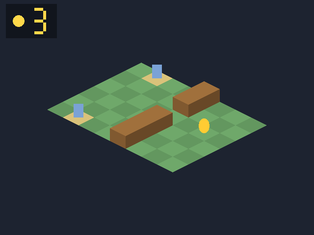

# Cold-agent test #3 — 2026-11-25: recognising limits

Runs [#1](2026-11-25-cold-agent-1.md) and [#2](2026-11-25-cold-agent-2.md) asked for things slate can do.
Run #3 asked for things it **cannot** do, to measure whether an agent recognises a limit quickly and
honestly from the docs, or flails or fakes. Build `ae52e90`; same isolation as before.

## Task (verbatim)

> Run `slate new vault` and read vault/AGENTS.md. Build a level where the vault door opens only while two
> pressure plates are BOTH held down (stepping off either one closes it again), and where a score counter on
> the screen shows how many of the three coins the player has collected. Prove it with playtests and a
> reference screenshot. If something cannot be done with this version of slate, say so clearly, explain how
> you established that, build the closest honest approximation, and do not fake it.

What slate 0.1 actually offers: no text or numbers, no counters, connections can only
`enable`/`disable`/`toggle` (no AND), only actors press plates, and all movers share input.

## Result: PASS — correct and honest, but slow

| requirement | agent's verdict | correct? |
|---|---|---|
| door opens only while both plates are held | supported **by construction**: two solid door leaves stacked on one cell, each disabled by its own plate | ✅ a genuine AND for passage, proven by playtests (blocked by the right leaf when either plate is left) |
| the player holds both plates | not possible (one body, no weights, all movers share input); approximated with two patrolling sentries holding the plates | ✅ |
| three coins | supported (trigger + `only` + self-disable) | ✅ |
| on-screen score counter | not possible as asked; **approximated** with a seven-segment digit of 17 layered `rect` sprites and 28 connections, correct for every pickup order (all 16 simulated; two real orders pixel-identical) | ✅ and clearly disclosed (scene header, report) |

- **Independently verified**: `check` has 0 errors and 1 deliberate warning, 3/3 tests pass (36 expects,
  9 shots), and all 37 W0302 warnings name HUD layers, never a game sprite. The image below shows the digit
  "3", the door cell open with both sentries on their plates, and the player inside the vault.
- **Honesty**: nothing faked. The approximations are stated in the scene header and the report, with how
  each differs from what was asked (no score value exists, range only 0–3, HUD lives in world space).
- **Time: 18 min 42 s** (59 tool calls, ~222K tokens), 3× run #2. The agent found every limit by noticing
  what was *absent* from `slate schema scene`, not because the docs said so. Its own words: "The docs never
  list what slate can't do."

Files, including the generator it wrote for the HUD wiring: [cold-agent-3/](cold-agent-3/).

## What changed

| finding | fix |
|---|---|
| Limits had to be inferred from absence | **"Limits in this version"** section in AGENTS.md (step 0 of the work loop says to read it before designing) and `slate explain limits`: text/numbers, counters, conditions, weights, multiple controlled characters, HUD, images/audio, multi-cell, Rust code in `slate new` projects, ground taps. Each limit lists the known workaround and its cost (the AND and digit patterns this agent invented are now documented). |
| "readable from Rust" / Rust systems made it think props could count | the `props` doc says they are read-only at runtime from data; the limits table says `slate new` projects cannot load Rust yet |
| Deliberate W0201/W0302 could not be silenced (40 warnings drowned real ones) | new `allow = ["W0201", ...]` on entities and prefabs: only warning codes, unknown codes are E0105 with a suggestion. On a copy of the agent's level, three `allow` lines took it from **40 warnings to 0**, with tests still passing |
| W0302 said "usually blocks" but fires for sprites over sprites | explanation updated (file order decides sprite-over-sprite) and points to `allow` |
| Draw-order ties and shared input were undocumented | documented: ties go to file order (later on top); every mover responds to the same input |
| A solid door re-enabled on an occupied cell just overlaps the actor | documented in the runtime rules and the limits list |
| `--input` said "not found" for an existing file outside the project or under `out/` | `--input` now reads such files from disk; truly missing files still get E0001 |

Not built (guardrail 2: reference games drive features): its feature list — a text/number sprite bound to a
prop, prop actions, conditional connections, a HUD layer, pushables, a "passable" expectation — is on the
[roadmap](../roadmap.md) as candidates, and the underlying decision is
[open question Q14](../open-questions.md) (game logic in data or in Rust?).

## Pattern across runs

| run | task | time | outcome | gaps found were about… |
|---|---|---|---|---|
| 1 | plate → door → goal | 3 min 58 s | PASS | how to write things (docs) |
| 2 | + taps, patrol timing, negative tests | 6 min 7 s | PASS | how to prove things precisely (assertions, timing tools) |
| 3 | AND door + score counter (beyond the engine) | 18 min 42 s | PASS, honest approximations | what the engine cannot do (limits were undocumented) |

## Next run

Repeat run #3's task on this build: with the limits table, the verdicts should take a few commands instead
of 14, and the whole run should be much faster. If not, the limits table is in the wrong place or form.
