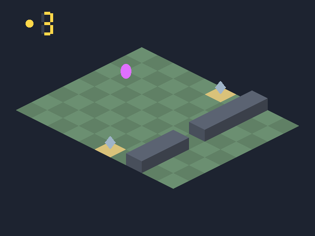

# Cold-agent test #4 — 2026-11-25: run #3's task again, with the limits table

Same prompt, same isolation and same success criteria as [run #3](2026-11-25-cold-agent-3.md), on build
`6e336b7`. The one intended difference is the new "Limits in this version" table (AGENTS.md and
`slate explain limits`).

## Result: PASS — every verdict at command 2

| | run #3 (no limits table) | run #4 (limits table) |
|---|---|---|
| verdicts reached at command | 7–21 (inferred from what the schema lacked) | **2** (`slate explain limits`, its first command after `slate new`) |
| wall time | 18 min 42 s | **14 min 6 s** (−25%) |
| tool calls | 59 | **37** (−37%) |
| tokens | ~222K | ~178K (−20%) |
| warnings in the final project | 40 (no way to silence intended ones) | **0** (used `allow` up front, as documented) |
| what it built | AND door; digit correct in any pickup order, wired per pickup (generated scene) | AND door; a **2-bit counter** in hidden stationary actors read by triggers, driving a 7-segment digit; 6 playtests incl. the doorway caveat and "counts once" |
| honesty | nothing faked, approximations stated | nothing faked, approximations stated in the verdict table, scene header and test docs |

The time saved on finding limits was spent on a more ambitious approximation (a real counter rather than
hand-wired layers) and on more thorough tests (7 playtests, 113 expects, 7 reference images).

**Independently verified:** `slate check` 0 errors, 0 warnings; 7/7 tests pass; the scene header documents
every workaround and caveat; `count_3_other_order.png` shows a lit "3" with dim unlit segments, the door
open, and no coins left.

Files: [cold-agent-4/](cold-agent-4/).

## What it found, and what changed

The limits table worked ("every verdict was reachable from command 2"). The gaps were now **recipes that were
vague or subtly wrong**:

| finding | fix |
|---|---|
| "a chain of toggles" can't count in any order; it needed an undocumented behaviour (enabling an actor on a trigger's cell fires the trigger) | the trigger rule is documented (occupancy is re-checked every step, including enable/disable, one step later) and a **"Counting in any order"** recipe describes the bit-actor pattern and its costs |
| the Collectible recipe could double-count (separate trigger stays enabled) | recipe rewritten: sprite and trigger on the **same** entity, which disables itself |
| the AND recipe didn't mention the doorway case | stated in the door and AND recipes |
| no documented stationary actor (it used `wander` confined to one cell with `step_frames = 6000`) | **Stationary actor** recipe: `patrol = { path = [[x, y]] }` on its own cell, which never moves and logs nothing (unit-tested) |
| value ranges only appeared in error messages | reference tables show ranges (`integer 1–600`, `number 0–64`, `integer ≥ 0`) |
| no projection formula for placing HUD sprites | the Coordinates rule gives the formula and points to `inspect`'s `screen` rectangles |
| an actor inside a solid wall gets no warning | new **W0206 actor-in-solid** (allowable for deliberate logic pieces) |
| W0304's title said "mostly hidden" but fires below 75% | title is now "Trigger tile is less than 75% visible" |

Found while writing the stationary recipe: a trigger that is occupied at frame 0 does not emit (by design), so
a weight that starts on a plate never opens its door. Now documented in the runtime rules and the recipe.

## Pattern across runs

| run | task | time | outcome | gaps were about… |
|---|---|---|---|---|
| 1 | plate → door → goal | 3 min 58 s | PASS | how to write things |
| 2 | + taps, patrol timing, negative tests | 6 min 7 s | PASS | how to prove things precisely |
| 3 | beyond the engine (AND door, score) | 18 min 42 s | PASS, honest | what the engine cannot do (undocumented) |
| 4 | run #3 again, with the limits table | 14 min 6 s | PASS, honest, 0 warnings | recipes that were vague or subtly wrong |

Each round's fixes removed that class of gap; the next round found a subtler one. The docs are converging.

## Next

The remaining cost in tasks like this is building logic out of parts the engine does not have. That is now
an owner decision, [Q14](../open-questions.md): add a small data-level logic set (counters, `when_all`, a
number display) or keep data minimal and make Rust game code easy.
