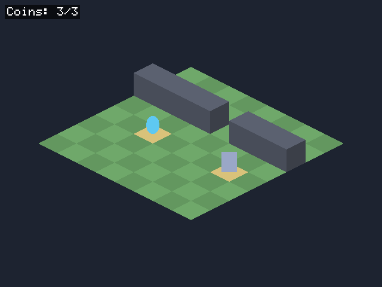

# Cold-agent test #5 — 2026-11-25: run #3's task with data logic v1

Same prompt, isolation and success criteria as [run #3](2026-11-25-cold-agent-3.md) and
[run #4](2026-11-25-cold-agent-4.md), on build `c965f7d`. That build adds
[ADR 0011](../decisions/0011-game-logic-data-first-rust-escape-hatch.md)'s data logic: `add`/`set` on props,
`when` conditions, `label` text and `screen_pos` HUDs. This run is ADR 0011's acceptance test.

## Result: PASS, with the logic fully supported. Two acceptance targets were missed

| requirement | agent's verdict | correct? |
|---|---|---|
| the door opens only while both plates are held | **supported**: the AND recipe (`when = [{ entity = "plate_b", occupied = true }]` and its mirror) | ✅ genuine, proven open and closed in both orders, with `skipped` events asserted |
| stepping off either plate closes it again | **supported**: `released` → `enable` | ✅ |
| a score counter on screen shows the coins collected | **supported**: a `hud` with `screen_pos`, `label = "Coins: {coins}/3"`, and coins that `add` 1 and disable themselves | ✅ a real prop, with `text` asserted at 0, 1, 2 and 3 |
| the player holds both plates | **not possible**: objects cannot hold plates, and there is only one controllable character. It confirmed this in a 45-second probe project | ✅ |
| the approximation used | a patrol "golem" paces onto plate_b every 60 frames; the player holds plate_a. Disclosed in the scene header, a prefab doc and the report, including that the player cannot walk through the open door (leaving the plate closes it) | ✅ honest |

**Verified independently:**
- `slate check`: 0 errors, 0 warnings.
- 3/3 playtests pass, with 42 expects and 3 shots. The walkthrough asserts every open/close transition, the
  HUD text at each count, and that no-op `enable` actions are counted.
- `vault_open.png` shows the door gap open, the player on plate_a, the golem on plate_b, no coins left and
  "Coins: 3/3" on the HUD.

Files: [cold-agent-5/](cold-agent-5/).

### Against ADR 0011's acceptance targets

| target | result |
|---|---|
| every requirement supported, no approximations | **Not met as written.** Every *logic* requirement is supported with no approximation (AND, re-close, on-screen count). The one remaining approximation is who holds the second plate: objects cannot hold plates and every mover follows the same input. ADR 0011 never set out to fix that, so the target was miscalibrated for this task, which needs two holders. |
| `slate check` clean, 0 warnings | **Met.** No warnings at any point in the run. |
| ≤ 5 min | **Missed: 10 min 2 s.** Run #4 took 14 min 6 s (−29%) and run #3 18 min 42 s (−46%). |
| budgets, determinism | **Met** (measured in `c965f7d`). |

### Where the time went

| span | what |
|---|---|
| 0:00–0:26 | `slate new`, AGENTS.md, `slate help`, `slate explain limits`: every verdict was reachable here |
| 0:26–4:58 | more `explain` and `help`, then design, mostly thinking: the golem's schedule and the input timing around it |
| 4:58–7:26 | build and prove it: the first scene checked clean (5:20); 3 playtests, 3 references, a deliberate E0402 check |
| 7:31–8:14 | a throwaway project confirming objects can't hold plates and two movers move together |
| 8:29–9:56 | final check, then the long report |

The logic took one write. Most of the remaining cost is the workaround for the second holder (design time
plus the probe) and the report itself.

| | run #3 | run #4 | run #5 |
|---|---|---|---|
| wall time | 18 min 42 s | 14 min 6 s | **10 min 2 s** |
| tool calls | 59 | 37 | **33** |
| tokens | ~222K | ~178K | **~149K** |
| warnings in the final project | 40 | 0 | **0** |
| scene size | 35 connections plus a generated HUD | 30 entity tables, 22 connections, 358 lines | **10 entity tables, 10 connections, 160 lines** |
| counter | 17 layered sprites, range 0–3 | 2-bit counter in hidden actors driving a 7-segment digit | **a prop and a label** |
| AND door | two stacked door leaves | two stacked door leaves | **`when` conditions** |

## What it found, and what changed

| finding | fix |
|---|---|
| The AND recipe reads as fully supported, but one player can hold only one plate, which you learn only by combining two rows of the limits table. A player holding a plate can never walk through the door | The AND recipe now says who can hold the plates (a pacing or stationary patrol), and that a player who must get through needs actors on both plates |
| The limits table is hard to match against a task's wording | Limit rows carry the phrasing tasks use ("crates or weights on plates", "put X on the plate", "two players, co-op, switching characters", "the player holds both plates") |
| `action` events include no-ops ("stays enabled"), but the docs said "A connection changed its target" | The docs say actions are logged every time the connection fires, even with no change; `action` events now carry `changed = true/false` |
| W0304's title ("less than 75% visible") did not say that things standing on the plate's own cell don't count, so a plate 68% covered by the golem gave no warning | Title: "Trigger tile is less than 75% visible behind things in front of it" |
| The shot report listed HUD entities at `cell (0, 0)` | The report and `inspect` print `screen` for screen entities; report JSON has `"cell": null` |
| The HUD showed "visible 88%": its own label counted as covering its own backdrop | An entity's pixels now count its footprint once: self-overlap is not "hidden" (the HUD reads 100%) |

Not built: an "AND that only one mover could ever satisfy" lint (a static check that is hard to make exact),
and the two features it ranked highest. Those are **objects that hold plates** (pushable blocks or a weight
component) and **switching control between characters**.

## Pattern across runs

| run | task | time | outcome | gaps were about… |
|---|---|---|---|---|
| 1 | plate → door → goal | 3 min 58 s | PASS | how to write things |
| 2 | + taps, patrol timing, negative tests | 6 min 7 s | PASS | how to prove things precisely |
| 3 | beyond the engine (AND door, score) | 18 min 42 s | PASS, honest | what the engine cannot do (undocumented) |
| 4 | run #3 again, with the limits table | 14 min 6 s | PASS, honest, 0 warnings | recipes that were vague or subtly wrong |
| 5 | run #3 again, with data logic v1 | 10 min 2 s | PASS; logic supported, 0 warnings | the one remaining limit (plate holders) and report details |

## Next

The AND door and the counter are no longer the cost. The one approximation left is the plate holder:
runs #3, #4 and #5 all built a patrol stand-in for it. That is the kind of evidence ADR 0011 asks for before
growing the engine. A small "weight" feature (objects that hold plates, e.g. a pushable block) would make
this task fully supported. That is the owner's call, and it is offered as the next step.
