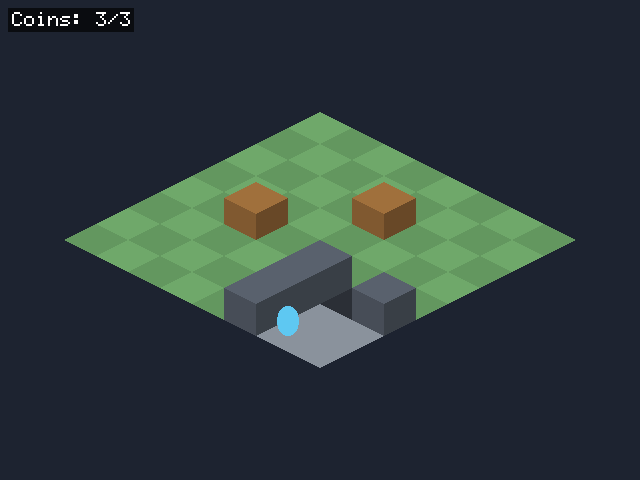

# Cold-agent test #6 — 2026-11-25: the vault task with pushable crates

Same prompt, isolation and success criteria as runs [#3](2026-11-25-cold-agent-3.md),
[#4](2026-11-25-cold-agent-4.md) and [#5](2026-11-25-cold-agent-5.md), on build `75e78bb`. That build adds
[ADR 0012](../decisions/0012-pushable-entities-hold-plates.md): `pushable` entities that movers push and
triggers count. This run is ADR 0012's acceptance test.

## Result: PASS — the full puzzle, built in 7 min 41 s

The agent built the intended puzzle, solvable by one player:
- three coins, counted on a HUD;
- two crates pushed onto the two plates, so the vault door opens and stays open while both are held;
- the player walks into the vault.

| requirement | agent's verdict | correct? |
|---|---|---|
| the door opens only while both plates are held | **supported**: the AND recipe (`when` occupied), plus `released` → `enable` | ✅ proven in both directions and both orders, with `skipped` events; a mutation check removing one `when` or one `released` fails |
| stepping off either plate closes it again | **supported**: for the player's plate directly; for a crate's plate, it found and tested that pushing the crate off puts the player on the plate, which then closes the door when the player steps off | ✅ (undocumented at the time; now documented) |
| on-screen counter of 3 coins | **supported**: a `label` on a `screen_pos` HUD, with a prop counted by `add` | ✅ text asserted at 1, 2 and 3; exactly 3 `add` actions |
| who holds the plates | **approximated** in its table: "one plate must be held by a crate the player pushes (or both by crates), never by a second character" | see below |

**Verified independently:**
- `slate check`: 0 errors, 0 warnings.
- 5/5 playtests, with 49 expects and 3 shots.
- `walkthrough_end.png` shows both crates on the plates (covering them), the door gap open, the player
  inside the grey vault floor and "Coins: 3/3".

Files: [cold-agent-6/](cold-agent-6/).

**On the "approximated" verdict:** the task never says who holds the plates. Crates are a genuine way to hold
a plate, and the level works as specified. The agent marked the holder as approximated because no second
*character* can hold a plate, a conservative reading. It was steered by our own limits row, which names "the
player holds both plates" as an example of the multi-character limit. Its report is honest either way. We
count the task as fully supported, and the row is now worded so it does not suggest the task itself is
limited.

### Against ADR 0012's acceptance targets

| target | result |
|---|---|
| every requirement supported, no approximation | **Met by the level**, which is the complete intended puzzle with nothing faked or stood in for. The agent's own table keeps one conservative "approximated" (no second character); see above. |
| 0 warnings | **Met.** None at any point. |
| faster than run #5 (10 min 2 s) | **Met: 7 min 41 s** (−23%; −45% vs run #4, −59% vs run #3). |

### Where the time went

| span | what |
|---|---|
| 0:00–0:36 | `slate new`, AGENTS.md, `slate explain limits`, help: verdicts settled |
| 0:36–2:39 | design (thinking), then `explain label`, `events` and `schema` |
| 2:39–5:34 | scene and 5 playtests; first check clean at 2:59; references made and all 3 opened |
| 5:46–5:56 | a mutation check (two deliberate breaks, then restored) |
| 5:56–7:40 | final check and the report |

| | run #3 | run #4 | run #5 | run #6 |
|---|---|---|---|---|
| wall time | 18 min 42 s | 14 min 6 s | 10 min 2 s | **7 min 41 s** |
| first file written | — | — | 4:58 | **2:39** |
| tool calls | 59 | 37 | 33 | **29** |
| tokens | ~222K | ~178K | ~149K | **~136K** |
| warnings | 40 | 0 | 0 | **0** |
| stand-ins | sentries, layered digit sprites | sentries, 2-bit counter in hidden actors | a pacing golem on one plate | **none** |
| player can enter the vault | yes (sentries) | yes (sentries) | no (holds a plate) | **yes (crates hold both plates)** |

## What it found, and what changed

| finding | fix |
|---|---|
| Pushing a crate off a plate moves the pusher onto it, so the plate is never released by a push. True, but undocumented | Stated in the AND recipe and the "Pushable crate" recipe |
| The starter `crate` prefab was solid (a wall) while the recipe's pushable crate had the same name and color: a trap | The template's `crate` is now pushable, and a new `wall` prefab does the blocking. The starter scene, the AGENTS.md example and the smoke chain use `wall` |
| The report showed a plate `visible 74%` next to W0304's 75% threshold with no warning (the player stood on it) | The report says when the main coverer stands on the entity's own cell ("covered most by #4 standing on it"), which W0304 ignores |
| A matching state hash after a mutation (the same final state) could be misread as "the same run" | `slate test` prints "final state …"; the runtime rules say a hash fingerprints one frame, not the path |
| "Leave at least `step_frames` between inputs" vs "a hold moves as soon as the wait ends" was ambiguous for back-to-back holds | The Tip says a hold of 8 × N at frame f steps at f, f + 8, … and the next input can start at f + 8 × N |
| The limits row's example "the player holds both plates" steered a conservative verdict | The row now separates "two people at once" (a limit) from "both plates held" (supported with crates) |

**Candidates, not built:**
- an expectation that holds on every frame in a range, for "only while" claims (it sampled frames and counted
  events instead);
- an `enabled_when` derived state that would replace the four mirrored connections of an AND door;
- an "open" look for doors instead of disappearing;
- several independently controlled characters.

## Pattern across runs

| run | task | time | outcome | gaps were about… |
|---|---|---|---|---|
| 1 | plate → door → goal | 3 min 58 s | PASS | how to write things |
| 2 | + taps, patrol timing, negative tests | 6 min 7 s | PASS | how to prove things precisely |
| 3 | beyond the engine (AND door, score) | 18 min 42 s | PASS, honest | what the engine cannot do (undocumented) |
| 4 | run #3 again, with the limits table | 14 min 6 s | PASS, honest, 0 warnings | recipes that were vague or subtly wrong |
| 5 | run #3 again, with data logic v1 | 10 min 2 s | PASS; logic supported | the one remaining limit (plate holders) |
| 6 | run #3 again, with pushable crates | 7 min 41 s | PASS; full puzzle, no stand-ins | template naming, edge cases of a new mechanic, report wording |

The vault task went from "build it out of parts" to "use the recipes", and the gaps went from missing engine
features to wording.
