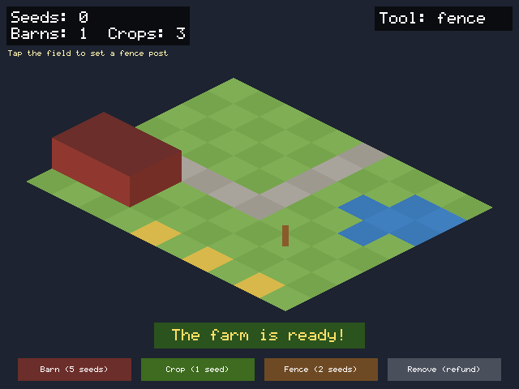

# Cold-agent test #7 — 2026-11-25: a farm builder on builder kit v1

The acceptance test of [ADR 0013](../decisions/0013-first-reference-game-isometric-builder.md): a builder task
that is **not** Tiny Town, on build `3e816b5`. Same isolation and report format as runs #3–#6 (a fresh
general-purpose agent, an empty folder outside the repo, only `slate new`'s files and slate's output).

## Task (verbatim)

> Run `slate new farm` and read farm/AGENTS.md. Build a small farm-building game. The ground is a field with a
> pond and a stone path that nothing can be built on. The player picks a tool from buttons on the screen, then
> taps the field to place it there: a barn (3 cells wide and 2 cells deep) costs 5 seeds, a crop patch (one
> flat cell) costs 1 seed, and a fence post (one cell) costs 2 seeds. The player starts with 10 seeds, and the
> seeds left are always shown on the screen. A remove tool takes back whatever the player taps and returns its
> seeds. When the farm has a barn and at least 3 crop patches, a message on the screen says the farm is ready.
> Prove with playtests: a build that pays, a placement refused on the pond, a placement refused because the
> spot is already taken, a purchase refused for lack of seeds, removing with a refund, and the ready message;
> plus a reference screenshot. If something cannot be done with this version of slate, say so clearly, explain
> how you established that, build the closest honest approximation, and do not fake it.

## Result: PASS — every requirement supported, 0 warnings, 8 min 44 s

| requirement | agent's verdict | correct? |
|---|---|---|
| field with a pond and a stone path nobody can build on | supported: a terrain `map` with `build = false` | ✅ refusals logged as "cell (8, 1) is pond, where nothing can be built" |
| tool buttons on the screen; tap the field to place | supported: the toolbar and ground-tap recipes | ✅ (caveat it noted: a barn grows from the tapped cell, it is not centred on it, as documented) |
| 3 × 2 barn for 5, flat crop for 1, fence post for 2 | supported: `footprint = [3, 2]`, a `tile`, a thin `rect` sprite | ✅ |
| 10 seeds, always on screen | supported: a `screen_pos` label | ✅ text asserted |
| remove tool with refund | supported, removal is a `disable` | ✅ a barn is rebuilt on the freed cells |
| "farm is ready" with a barn and ≥ 3 crops | supported: counters, `changed` + `when`; it also hides the message again when it stops being true | ✅ on, off after a removal, on again |
| the six playtests and a screenshot | supported | ✅ 6 playtests, 59 expects, 1 shot |
| (not asked) "can't build there" feedback | not possible: refused spawns emit no signal (it quoted the limits row) | ✅ honest; it built "Not enough seeds" with the documented workaround |

**Verified independently:**
- `slate check` gives 0 errors and 0 warnings; 6/6 playtests pass.
- `ready.png` shows a red 3 × 2 barn, three gold crop patches, a fence post, the L-shaped path and the pond,
  "Seeds: 0" and the "The farm is ready!" banner.
- It ran a deliberate negative control (E0401) and a deliberate E0105 probe. It recoloured adjacent crop tiles
  that had merged visually before writing the reference.
- It is original work: 355 lines, 30 connections. Files: [cold-agent-7/](cold-agent-7/) (with `slate.toml`, so
  `slate test` runs there).

Its summary: "Nothing led me to believe something was possible when it wasn't. Every limit I hit was in the
limits table, and every recipe worked as written."

### Against ADR 0013's acceptance target

| target | result |
|---|---|
| terrain, tap-to-build with costs, a multi-cell building, clear with refund, playtests that prove each rule | **Met**: every rule has a playtest. "Refused for lack of seeds" was proven indirectly (counts, seeds, hint text) because event expectations could not filter by prefab; that filter is now built. |
| 0 warnings | **Met**: none at any point. |

| | run #6 (vault, pushables) | run #7 (farm, builder kit) |
|---|---|---|
| wall time | 7 min 41 s | 8 min 44 s |
| first file written | 2:39 | 3:00 |
| tool calls | 29 | 28 |
| tokens | ~136K | ~156K |
| playtests / expects | 5 / 49 | 6 / 59 |
| warnings | 0 | 0 |

It took a new kit, a bigger task and six required proofs, and finished in about the same time as the fourth
attempt at the vault task.

## What it found, and what changed

| finding | fix |
|---|---|
| **False pass:** `slate test out/neg_pond.toml` ignored a playtest outside `tests/` and ran the six project tests (exit 0). A negative control run this way "passes" | `slate test <file>` now runs exactly that file, wherever it is in the project (read from disk if the file scan skips it, as in `out/`). A scene, prefab or `slate.toml` is refused with E0003. The smoke chain checks that a broken copy under `out/` fails |
| "Refused for lack of seeds" could not be asserted directly: event expectations have no prefab filter | `[[expect]] event` + `prefab` counts only events about that prefab: its spawns, refused spawns and skipped spawns, and events whose subject is a copy. A recipe shows the before/after count around the tap. Tiny Town's `refusals` test now uses it (5 refused houses; exactly one tree spawn stopped by coins) |
| AGENTS.md's format section had no table for `[[terrain]]` keys or `when` condition keys | Both tables are in the format reference (and so in AGENTS.md) |
| "A taken cell" refusal is subtler than the recipe said: a tap **on** an object hits the object, so no placement is attempted | The recipe says so, and how `occupied` really arises: a footprint overlap, or visible ground of a taken cell. `--place` shows it without tapping |
| Removal was described two ways (a limits row "Deleting entities" vs the "Remove what you tap" recipe) | The "Supported" paragraph lists removing what the player taps (`disable`); the limits row is now "Deleting entities from the world's list", pointing back to it |
| `inspect` text printed `text … at screen [8,62]` (the `screen_pos`) next to `screen [10,62,…]` (the drawn box, with the label offset) | It prints `(screen_pos [8,62])` |

**Candidates, not built** (the agent's feature suggestions, which match what Tiny Town needed):
1. **A signal on refused placements** (e.g. the ground emits `refused` with the reason). The agent's "most
   important missing feature for a builder game"; Tiny Town's spec lists the same gap.
2. **`when` conditions that count copies** (`{ prefab = "crop", at_least = 3 }`). Both games keep hand-made
   counters that two connections per prefab must update on build and on remove.
3. A placement anchor option (centred on the tap) for multi-cell buildings.

## Pattern across runs

| run | task | time | outcome | gaps were about… |
|---|---|---|---|---|
| 1 | plate → door → goal | 3 min 58 s | PASS | how to write things |
| 2 | + taps, patrol timing, negative tests | 6 min 7 s | PASS | how to prove things precisely |
| 3 | beyond the engine (AND door, score) | 18 min 42 s | PASS, honest | what the engine cannot do (undocumented) |
| 4 | run #3 again, with the limits table | 14 min 6 s | PASS, honest, 0 warnings | recipes that were vague or subtly wrong |
| 5 | run #3 again, with data logic v1 | 10 min 2 s | PASS; logic supported | the one remaining limit (plate holders) |
| 6 | run #3 again, with pushable crates | 7 min 41 s | PASS; full puzzle, no stand-ins | template naming, edge cases, report wording |
| 7 | a new builder game (the kit's first cold use) | 8 min 44 s | PASS; everything supported, 0 warnings | a CLI false pass, proving refusals precisely, two missing tables |
