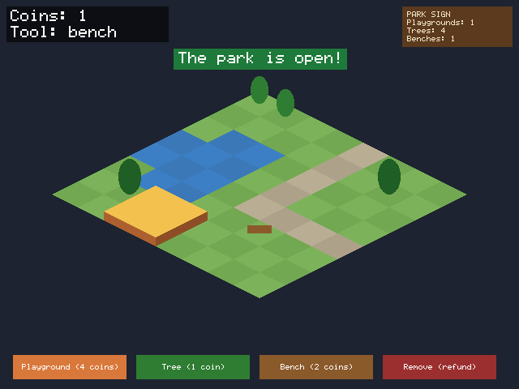

# Cold-agent test #8 — 2026-11-25: a park builder on builder kit v2

The acceptance test of [ADR 0014](../decisions/0014-refusal-signal-and-count-props.md) (`refused` and
`counts`), on build `ffcb792`. The setup was the same as runs #3–#7: a fresh general-purpose agent, an empty
folder outside the repo, the release binary, and only `slate new`'s files and slate's output as docs.

## Task (verbatim)

> Run `slate new park` and read park/AGENTS.md. Build a small park-building game. The ground is a meadow with
> a lake and a gravel path; nothing can be built on the lake or the path. Two old trees already stand in the
> meadow. The player picks a tool from buttons on the screen, then taps the meadow to place it there: a
> playground (2 cells wide and 2 cells deep) costs 4 coins, a tree costs 1 coin, and a bench costs 2 coins.
> The player starts with 9 coins, and the coins left are always shown on the screen. A sign on the screen
> shows how many playgrounds, trees and benches the park has (the old trees count). A remove tool takes back
> whatever the player taps and returns its coins (an old tree returns 1 coin). When a placement does not
> happen, a message on the screen tells the player why: on the water or the path, the spot is already taken,
> or not enough coins, each in your own words; the message goes away after the next successful placement or
> tool choice. When the park has a playground, at least 4 trees and at least 1 bench, a message on the screen
> says the park is open; it goes away again if that stops being true. Prove with playtests: each of the three
> refusal messages, a build that pays, removing an old tree with a refund (and the count going down), and the
> open message appearing and disappearing; plus a reference screenshot. If something cannot be done with this
> version of slate, say so clearly, explain how you established that, build the closest honest
> approximation, and do not fake it.

The task asks for both v2 features directly: messages that explain refusals, and counts that include copies
placed in the scene and drive a goal that can come and go.

## Result: PASS — every requirement supported, 0 warnings, 6 min 24 s

| requirement | agent's verdict | correct? |
|---|---|---|
| lake and gravel path that nothing can be built on | supported: terrain `map`, `build = false` | ✅ |
| two old trees that count | supported: two `prefab = "tree"` entities; the sign's `counts` includes them | ✅ the sign shows `Trees: 2` at frame 0 |
| toolbar, tap to place, 2 × 2 playground for 4, tree 1, bench 2, 9 coins on screen | supported (recipes) | ✅ coins 9 → 5 → 4 → 2 asserted |
| sign with the three counts | supported: `counts = { playgrounds = ..., trees = ..., benches = ... }`, **no counting connections** | ✅ |
| remove with refund, an old tree returns 1, the count goes down | supported | ✅ trees 2 → 1 → 0, coins 9 → 10 → 11; a tree is replanted on the freed cell |
| "on the water or the path" message | supported: ground `refused` + `when = [{ reason = "terrain" }]` | ✅ (one message for both: `reason` cannot tell terrains apart, which it noted) |
| "spot taken" message | supported: `refused` with `occupied`, **plus** a per-prefab `tapped` connection for taps on the object itself | ✅ three cases tested |
| "not enough coins" message | supported: the opposite `when`, as the limits row and recipe say | ✅ all three tools tested |
| (not asked) a footprint over the edge | supported: a fourth message on `reason = "edge"` | ✅ it found the edge case on its own |
| message clears on the next success or tool choice | supported: buttons' `tapped` and each prefab's `spawned` clear it | ✅ |
| "park is open" that comes and goes | supported: the sign's `changed` with `when` on the count props (enable once, disable per failing condition) | ✅ open → closed → open → closed in one test |
| playtests and a screenshot | supported | ✅ 6 playtests, 78 expects, 2 shots |

**Verified independently:**
- `slate check` gives 0 errors and 0 warnings, and 6 of 6 playtests pass. Both still pass on the current
  build.
- `park_open.png` shows a 2 × 2 playground, four trees (two old, darker), a bench, "Coins: 1", the sign at
  1/4/1 and the "The park is open!" banner. `refuse_water_path.png` shows the hint "You can't build on the
  lake or the gravel path."
- Mutation checks in a copy:
  - answering `edge` instead of `terrain` fails `refuse_water_path`;
  - counting the wrong prefab fails 4 of the 6 playtests.
- It ran its own negative control (an E0401 on purpose).
- It is original work: 470 lines of scene, 41 connections. Files: [cold-agent-8/](cold-agent-8/).

Its summary: "Nothing I tried behaved differently from the docs; everything that looked possible was
possible."

| | run #6 (vault) | run #7 (farm, kit v1) | run #8 (park, kit v2) |
|---|---|---|---|
| wall time | 7 min 41 s | 8 min 44 s | **6 min 24 s** |
| first file written | 2:39 | 3:00 | **1:53** |
| tool calls | 29 | 28 | **19** |
| tokens | ~136K | ~156K | ~135K |
| playtests / expects | 5 / 49 | 6 / 59 | 6 / 78 |
| warnings | 0 | 0 | 0 |

The task was the largest so far: three refusal messages, counts that include placed copies, and a goal that
switches off again. It was also the fastest builder run: v2's recipe covered the new parts, and the scene
passed `check` the first time.

## What it found, and what changed

| finding | fix |
|---|---|
| `inspect --place tree@6,1` printed the whole entity table before the one-line answer | `--place` alone prints only the answer (`--entity` brings the table back) |
| Spawned copies showed as `#10` in the `inspect` and `shot --report` tables, while messages say `#10 (house)` | Unnamed copies of a prefab are `#10 (house)` everywhere: tables, "covered most by", event text, expectation notes |
| The "say why" recipe covered only ground refusals; that a tap **on** an object never reaches the ground was in another recipe | The recipe says so and shows the per-prefab `tapped` connection with the build tool's condition |
| Which wins when coins are short *and* the tap is on the lake? (It guessed correctly.) | The recipe states it: the spawn's `when` is checked first, so with too few coins no placement is tried and no `refused` follows |
| A screen entity's tap pixel moved when its label text changed | "Buttons you tap" says the box grows with the text; tap fixed-text buttons, or ask `inspect` at that frame |
| No "not equal" in `when` (it added a `building` flag prop) | Listed in the limits row, with both workarounds (one connection per value, or a flag prop) |
| Lake and path cannot get different messages | Listed under behaviours: `reason = "terrain"` covers every unbuildable terrain; the `blocked` event's `terrain` field says which |

**Its feature requests, in its order:**
1. **Several actions in one `[[connect]]`** ("about 50 connect tables for a small game; buttons alone take
   12"). Measured across the three builder games: merging connections that share source, signal and `when`
   would cut the park from 41 to 27, the farm from 30 to 19, and Tiny Town from 27 to 24.
2. A `not_equals` / `in = [...]` condition.
3. Price and refund declared on the prefab, with an automatic "can't afford" refusal.
4. `when` on the refused cell's terrain name.
5. Derived props (`open = all(...)`), instead of one enable plus three disable connections.
6. Highlighting the chosen tool and previewing a placement.
7. Inspect improvements: done above.

## Pattern across runs

| run | task | time | outcome | gaps were about… |
|---|---|---|---|---|
| 1 | plate → door → goal | 3 min 58 s | PASS | how to write things |
| 2 | + taps, patrol timing, negative tests | 6 min 7 s | PASS | how to prove things precisely |
| 3 | beyond the engine (AND door, score) | 18 min 42 s | PASS, honest | what the engine cannot do (undocumented) |
| 4 | run #3 again, with the limits table | 14 min 6 s | PASS, honest, 0 warnings | recipes that were vague or subtly wrong |
| 5 | run #3 again, with data logic v1 | 10 min 2 s | PASS; logic supported | the one remaining limit (plate holders) |
| 6 | run #3 again, with pushable crates | 7 min 41 s | PASS; full puzzle, no stand-ins | template naming, edge cases, report wording |
| 7 | a new builder game (kit v1's first cold use) | 8 min 44 s | PASS; everything supported, 0 warnings | a CLI false pass, proving refusals precisely, two missing tables |
| 8 | a bigger builder (kit v2: refusal messages, counts) | 6 min 24 s | PASS; everything supported, 0 warnings | output noise, one cross-recipe fact, **how much wiring a game needs** |

The gaps have moved from "can it be done?" to "how much has to be written?". The next lever is the number
of tables, not missing capability.
