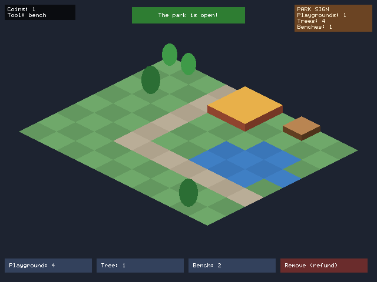

# Cold-agent test #9 — 2026-11-25: run #8's park, with `actions` lists

The acceptance test of [ADR 0015](../decisions/0015-several-actions-per-connect.md) (several actions per
`[[connect]]`), on build `0304e59`. It used **the same task, word for word, as
[run #8](2026-11-25-cold-agent-8.md)**, so the only variable is the new feature. The setup was the same as
before: a fresh general-purpose agent, an empty folder outside the repo, the release binary, and only
`slate new`'s files and slate's output.

## Result: PASS — every requirement supported, 0 warnings, 24 connections instead of 41

| | run #8 (kit v2) | run #9 (+ `actions`) | change |
|---|---|---|---|
| `[[connect]]` tables | 41 | **24** (10 with `actions`) | **−41 %** |
| scene lines | 470 | 369 | −21 % |
| wall time | 6 min 24 s | **5 min 54 s** | −8 % |
| first file written | 1:53 | 1:51 | — |
| tool calls | 19 | 21 | — |
| tokens | ~135K | ~132K | — |
| playtests / expects | 6 / 78 | 7 / 76 | — |
| warnings | 0 | 0 | — |

The estimate in ADR 0015 was 41 → 27 tables. The agent did better (24): it also folded "clear the
message" into each spawn's list, which the estimate did not count.

Requirements and verdicts match run #8:
- every requirement was supported;
- the lake and the path share one message, which the docs list as a limit;
- it added an `edge` message and a "pick a tool first" message without being asked.

How it used the new rules:
- **Buttons:** each is one list (set the tool, set a `building` flag, clear the message).
- **Each spawn:** one list, `[spawn, pay, clear message]`. It named the rule it relied on: "a refused spawn
  stops the list, so nothing is paid".
- **The order rule:** it put each "not enough coins" connection **before** its spawn, as the recipe says.
- **Each removal:** `[disable self, refund]`.

**Verified independently:**
- `slate check` gives 0 errors and 0 warnings, and 7 of 7 playtests pass, on its build and on the current
  one.
- `park_open.png` shows a playground, four trees (two old), a bench, the sign at 1/4/1, "Coins: 1" and
  "The park is open!". `refuse_terrain.png` shows the lake/path message.
- Mutation checks in a copy:
  - paying before spawning a bench (`[pay, spawn]`) fails `refuse_terrain`;
  - moving the playground's "not enough coins" connection after its spawn passes all 7 playtests. Its game
    has the order right, but no test spends the coins below a price, so a regression would go unnoticed.
    That is the trap ADR 0015 named. The recipe now says how to prove it, and Tiny Town has such a guard.
- It is original work: 369 lines of scene. Files: [cold-agent-9/](cold-agent-9/).

## What it found, and what changed

| finding | fix |
|---|---|
| `slate shot -o out/x.png` said "takes at most 1 argument(s), got 2: -o out/x.png": a short flag was taken for a path | Any `-x` is an error naming the long flag: "`slate shot` has no flag `-o`", hint "slate has long flags only: did you mean `--out`?" |
| `inspect --events --entity hint` showed "'hint' set skipped … coins >= 4 does not hold" with nothing saying it was the 3rd action of a spawn list | In a list of two or more, every message says "action 3 of 3" and the event data has `item` |
| `event = "action"` also counts actions that changed nothing, so on/off transitions could not be counted (run #8 hit the same thing) | `[[expect]] event = "action"` + `changed = true` (or `false`). Tiny Town's banner gets 11 `set`s and 1 real change, now asserted exactly |
| The recipe clears the message on every tap, but the task wanted it to stay until the next success | The recipe shows clearing as the last action of the spawn's list and in each button's list, and how to prove the coin-message order |
| Not sure whether a tree with a `sprite` override still counts as a `tree` | `counts` and `from_prefab` say so: a copy is a copy whatever keys it overrides |
| A suggested tap pixel sat exactly on another sprite's bottom edge, and "does it hit?" was unclear | The recipe says pixel centers are tested, with a worked example |
| There is no way to change a color at runtime to highlight the chosen tool | Limits: looks are fixed per entity; stack a highlight entity and switch it with one `actions` list |

**Its feature requests, in its order** (run #8's list in brackets):
1. "Not equal" / `not` in `when`, or an else branch [#2].
2. Costs as data on the spawn, with a built-in refusal reason `funds`, so "not enough coins" becomes a real
   `refused` and the file-order rule goes away [#3].
3. A tap on a building with a spawn tool emits `refused` (`occupied`) [mentioned in #8's confusions].
4. Derived boolean props (`open = all(...)`) [#5].
5. Runtime style changes (highlight the chosen tool) [#6].
6. A terrain-name condition on `refused` [#4].
7. An expect filter for real changes: **done** above.

Two runs now ask for (1) and (2). (2) would also remove the last ordering trap in builder games.

## Pattern across runs

| run | task | time | outcome | gaps were about… |
|---|---|---|---|---|
| 7 | a new builder game (kit v1's first cold use) | 8 min 44 s | PASS; everything supported, 0 warnings | a CLI false pass, proving refusals precisely, two missing tables |
| 8 | a bigger builder (kit v2: refusal messages, counts) | 6 min 24 s | PASS; 41 connections | output noise, one cross-recipe fact, how much wiring a game needs |
| 9 | run #8's task again, with `actions` | 5 min 54 s | PASS; **24 connections** | a short-flag error, list messages, proving real changes |
