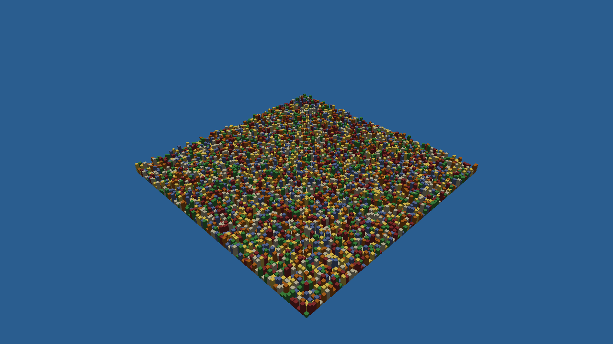

# Proposal: the 3D architecture (open question Q16) — for the owner's approval

> Status: **proposed, 2026-11-25; the owner said to continue the same day.** The architect reads that as
> approval of the five points in section 6 and of the order in section 7, and has told the owner so. Each
> point is still written up as an ADR, with its own evidence, when it is built. Nothing here is built into
> the engine yet. It is the 3D direction study the
> owner asked for after the [direction update](../vision.md#direction-update--2026-11-25-owner): measured
> spikes, one proposed architecture, new budgets and a new order of work. The spike code is in
> [3d-architecture/spikes/](3d-architecture/spikes/), so every number can be measured again. All numbers are
> from an Apple M5 Pro unless they say otherwise.

## 1. The proposal in one page

**Split the engine into two halves, joined by one list.**

```text
 text files ─► checks ─► deterministic simulation ─► RENDER LIST ─┬─► CPU reference renderer ─► PNG, image
 (rwgpu.toml, scenes,     (fixed step, cell index,   (camera, light, │   (owned, exact, no GPU)    hash, frame
  prefabs, shapes)         Rust systems)              instances)     │                             report, picking
                                                                     └─► wgpu renderer ─► native window, browser,
 └──────────── the agent's loop: no GPU, no window, small ──────────┘    (players)          later phones and tablets
```

1. **The agent's loop stays free of the GPU.** `check`, `run`, `test`, `shot` and `inspect` keep working on a
   machine with no GPU, inside today's size and dependency limits. A **CPU reference renderer** draws the 3D
   scene for them, exactly and identically on every platform.
2. **Players draw the same list with wgpu**, natively and in the browser from one code path. wgpu lives in
   its own crates with its own budgets and never enters the agent's loop.
3. **The two renderers are held together by a test.** In the spike they differ by 1 to 18 pixels out of
   921,600. What an agent verifies is what a player sees.
4. **The world becomes 3D without breaking the files.** Height is already the third coordinate. Today's
   scenes stay valid and are simply seen through a 3D camera.
5. **The simulation gets a cell index**, then column storage where measured. Today it is quadratic and stops
   at under 4,000 moving actors; with an index, 500,000 take 1.5 ms per step.
6. **Art is shapes written as text**, turned into meshes by the engine and drawn as instances.

The measurements say this is affordable: wgpu adds about 10 s to a clean build and nothing to the edit loop;
a WebGPU-only web build of the spike is 117 KB; half a million boxes draw in 2 ms; and a 150-line CPU
renderer with no dependencies reproduces the GPU's frame.

Section 6 lists the five points that need the owner's approval, and section 7 the order of work.

## 2. What the owner has decided (the frame for this study)

3D on the GPU; the renderer **through wgpu**; **native and web from the start**, phones and tablets
reachable; smart choices and no bending for old systems; strategy games, city builders, car-building and
simulation games, children's games, each with a template; a town first on an architecture sized for a city;
"simple" means the assets; licence Apache-2.0; the engine is rwgpuengine.

## 3. Measurements

### 3.1 What wgpu costs to build

wgpu 30.0.2, a scratch crate that only depends on wgpu, on this Mac.

| | the engine today | wgpu added |
|---|---|---|
| crates compiled (macOS) | 23, of which 16 are rented | **59** for wgpu alone; **80** with a window library (winit 0.30) |
| the same on other systems | — | wgpu alone: Windows 73, Linux 62, Android 67, iOS 59; with winit: Windows 84, Linux 113, Android 95, iOS 74 |
| proc-macro crates | 0 | 4 (`thiserror-impl`, `bytemuck_derive`, `zerocopy-derive`, `document-features`) |
| clean build, dev / release | 2.5 s / 3.1 s | 9.9 s / 12.0 s |
| **rebuild after an edit**, dev / release | 0.4 s | **0.3 s / 0.4 s** |
| release binary, stripped | 1.9 MB (the command) | 4.5 MB (the spike) |

The edit loop, which is the speed limit of an agent, does not change: wgpu is compiled once, and an edit to
engine or game code only rebuilds the crates above it. The cost is paid in the clean build and in the
dependency and proc-macro counts, which is why wgpu must stay out of the agent's half.

### 3.2 What wgpu costs to run: one town, three sizes

One generated town of N boxes (12 triangles each), flat-shaded by one light, 1280 × 720, with a depth buffer.
The time is from encoding the frame until the GPU has finished it. The second number re-uploads every
instance each frame, as if everything moved.

| boxes | triangles | native (Metal) | native, all re-uploaded | browser (Chromium 156, WebGPU) | browser, all re-uploaded |
|---|---|---|---|---|---|
| 5,000 | 60,000 | 0.37 ms | 0.25 ms | 0.47 ms | 0.50 ms |
| 50,000 | 600,000 | 0.54 ms | 0.65 ms | 1.02 ms | 2.23 ms |
| 500,000 | 6,000,000 | 1.93 ms | 3.18 ms | 2.26 ms | 5.33 ms |

- **The browser draws exactly the native pixels.** The frame read back in Chromium has the same hash as the
  native one for all three sizes (`8b190eb1…`, `7c901f08…`, `15292f1b…`). It is the same Rust code and the
  same shader, compiled twice.
- Starting up: 92 ms to a device natively, 47 ms for the shader and pipeline.
- This is plain instancing with no culling and no levels of detail. A phone's GPU is perhaps ten to thirty
  times slower, so a city on a phone will need both. A town will not.

### 3.3 What wgpu costs on the web: size

The same spike compiled for the browser, size-first, with wasm-bindgen 0.2.130.

| build | wasm | gzipped | JavaScript glue | crates |
|---|---|---|---|---|
| **WebGPU only** | **116,791 bytes** | 45,815 | 46 KB (9.5 KB gzipped) | 39 |
| WebGPU, plus the WebGL2 fallback for browsers without WebGPU | 1,850,824 bytes | 689,002 | 102 KB | 62 |

With WebGPU only, wgpu is a thin layer over the browser's own implementation. The fallback brings wgpu's
whole core and its shader compiler into the download: sixteen times the size. Today's whole web module is
586 KB, so a WebGPU-only player stays under a megabyte.

WebGPU is in Chrome and Edge 113 and later, Chrome for Android 121 and later (Android 12 and up), Safari 26
(macOS, iOS and iPadOS 26), and Firefox 141 on Windows and 145 on Apple-silicon Macs. Firefox on Android and
Linux did not have it at the time of the sources.

### 3.4 A CPU reference renderer for 3D

`spikes/cpu_ref`: 150 lines, no dependencies, one thread, not optimised. It projects with exact float
operations, snaps to 1/256 of a pixel, rasterises triangles with integers and a top-left rule, and keeps a
depth and an **owner** (which box) for every pixel.

| boxes | CPU reference | pixels different from the GPU frame | boxes that own at least one pixel |
|---|---|---|---|
| 5,000 | 4.9 ms | **1** of 921,600 | 4,105 |
| 50,000 | 11.8 ms | **8** of 921,600 | 35,611 |
| 500,000 | 63.9 ms | **18** of 921,600 | 148,101 |



- **It is deterministic across processors:** the three images have the same hashes built for arm64 and for
  x86-64 (run under Rosetta 2).
- **The owner buffer is the frame report.** "Which entities are visible, hidden or off-screen" falls out of
  it, as it does from the 2D rasterizer today. The last column is that answer.
- 5 to 64 ms is slow for a player and fine for `shot` and `test`.

So the vision's "built-in visual checks, with or without a GPU" survives the move to 3D, and the gap between
what the agent checks and what the player sees is a handful of edge pixels that a test can bound.

### 3.5 The simulation at scale

**Today's engine**, N actors that each try one step per frame (`rwgpu run`):

| actors | load and check | one step |
|---|---|---|
| 1,000 | 8 ms | 1.3 ms |
| 5,000 | 43 ms | 26.6 ms |
| 20,000 | 392 ms | 426 ms |
| 50,000 | 2,373 ms | 2,777 ms |

It is quadratic: "is this cell free?" scans every entity, and so do several load-time checks. Under 4,000
moving actors fit in a 60 Hz frame. Every move also writes a sentence into the event log.

**The same movement in a scratch benchmark** (`spikes/scale_bench`), three ways, all giving the same result:

| actors | scan all entities (today) | entities as today, plus a cell index | positions in a column, plus a cell index |
|---|---|---|---|
| 5,000 | 12.8 ms | 0.015 ms | 0.015 ms |
| 50,000 | 1,462 ms | 0.165 ms | 0.148 ms |
| 500,000 | not run | 5.39 ms | **1.54 ms** |

An entity is 432 bytes today. A cell index (which entity is on each cell) is the large gain and is needed
first. Storing positions in their own array matters only at city scale, where it is 3.5 times faster again.

## 4. The proposed architecture

### 4.1 Two halves and the crates

| crate | half | holds | may depend on |
|---|---|---|---|
| `rwgpuengine_core`, `_data`, `_sim` | agent's loop | as today; `_sim` gains the cell index and Rust systems | no GPU, no window, no proc macros |
| `rwgpuengine_render` | agent's loop | the **render list**, shapes into meshes, the CPU reference renderer, the frame report, picking | the same |
| `rwgpuengine_runtime`, `_cli` | agent's loop | sessions, playtests, the `rwgpu` command | the same |
| `rwgpuengine_gpu` (new) | players | draws a render list with wgpu; no window | wgpu |
| `rwgpuengine_player` (new) | players | a native window and a browser canvas around `_gpu` | winit, wasm-bindgen |
| `rwgpuengine` (new) | both | the one crate a game's Rust code depends on | re-exports |

`rwgpu` stays GPU-free. Players are separate programs (`rwgpu play` starts one if it is installed). On
Windows and Linux the GPU half can only be proven by CI, which is one reason the first public push comes
early in section 7.

### 4.2 The render list

ADR 0007 made the draw list the one thing every consumer reads. In 3D it becomes the **render list**: a
camera, a light, and instances (mesh, position, turn, size, color, owning entity), plus today's 2D draw list
as an overlay for HUD and text. The simulation produces it; nothing in it depends on a GPU.

- The **CPU reference renderer** reads it for `shot`, `test`, reports and picking.
- The **wgpu renderer** reads it for players: one instanced draw per mesh.
- A check, run wherever a GPU exists, renders both and fails if they differ by more than a few pixels.

**The rule that keeps agents honest:** a visual feature goes into the reference renderer first. Something
only the GPU does must be declared presentation-only (anti-aliasing is the example) and is left out of the
comparison. This limits lighting to what the reference can also draw; see decision A4.

### 4.3 The world in 3D

- **Height stays the third coordinate** (`pos = [x, y, z]`, z up). Tiny Town's files do not change; its
  blocks become boxes under a 3D camera. The isometric view becomes one camera preset.
- **Turning:** an entity gets a turn about the vertical axis. Quarter turns for buildings on a grid, a free
  angle for vehicles. Full 3D orientation waits for a game that needs it.
- **The grid stays**, now also as the cell index for free movement over it.
- **Deterministic math:** ADR 0005 holds. Rotation needs sine and cosine, which become owned functions built
  from exact operations. The GPU's results never flow back into the simulation.
- **The camera is part of the session's state**: orbit, pan and zoom arrive as input and are replayed by
  playtests, because what a tap hits depends on them.
- **Events at scale:** a sentence for every move of 50,000 actors is not affordable. Events become something
  an agent turns on for the entities it is asking about, with counts for the rest.

### 4.4 Storage

The cell index first, when the 3D core is built. Column storage and entity ids that can be reused come with
the first game that reaches city scale, with a measurement. This replaces ADR 0006 and is the postponed
restructuring of `world.rs` and `load.rs`.

### 4.5 Shapes as text

A prefab lists shapes; the engine builds one mesh per prefab and draws its copies as instances.

```toml
# prefabs/house.toml
footprint = [2, 2]

[[shape]]
kind = "box"
size = [2, 2, 1.5]
color = "#b5651d"

[[shape]]
kind = "roof"          # a gable roof sitting on the box
at = [0, 0, 1.5]
size = [2, 2, 0.8]
color = "#8b2f2f"
```

A small closed set to start (box, wedge, roof, prism, cylinder, extruded outline), each validated by
`rwgpu check` and named in the frame report. Today's `block` and `tile` are the first two shapes. The exact
set is pulled by the town reference game, not designed ahead of it.

### 4.6 The web

The web player is the engine plus wgpu's WebGPU backend, built with wasm-bindgen. This replaces ADR 0008 for
the player only. **WebGPU only**: no WebGL2 fallback. Where WebGPU is missing, the page falls back to the
CPU reference renderer, which already has to exist: slower, but it shows the game, and it costs no extra
code path.

### 4.7 Not decided here, on purpose

| topic | when |
|---|---|
| Physics for car-building and simulation games (owned and simple, or a rented deterministic library) | with the car template's spec |
| Shadows and richer lighting | when a reference game needs them, under the rule in 4.2 |
| Mesh import (glTF, flat colors) | when a game needs a shape text cannot describe |
| Hot reloading Rust game code | with the Rust game-code path |
| Phone and tablet shells, and reference devices | after the web player; wgpu's dependency tree for iOS and Android is 59 and 67 crates (counted, not built here) |
| Real fonts and other scripts (Q5) | with the first template that needs them |

## 5. Budgets

Today's budgets stay as they are, for the agent's half. The players get their own.

| budget | limit | measured in the spikes |
|---|---|---|
| agent's half: rented crates / proc macros / web module / rebuild | 20 / 0 / 800,000 bytes / 10 s | 16 / 0 / 585,789 / 0.4 s |
| players: crates on the widest system (Linux) | 130 | 113 |
| players: proc-macro crates | 6 | 4 |
| players: clean release build | 60 s | 12 s |
| players: web download, engine and wgpu, before a game's own code | 1,500,000 bytes | about 700,000 |
| GPU frame, 50,000 instances at 1280 × 720, this Mac | 4 ms | 0.54 ms |
| CPU reference frame, 5,000 instances at 1280 × 720 | 20 ms | 4.9 ms |
| simulation step, 50,000 moving actors | 2 ms | 0.15 ms |
| the two renderers on the reference scenes | at most 50 pixels apart | 1 to 18 |

## 6. What needs the owner's approval

| # | decision | recommendation | why |
|---|---|---|---|
| A1 | The two halves: the agent's loop never needs a GPU, and a CPU reference renderer is the source of truth for checks. | Yes. | It keeps everything that makes the engine agent-native, and 3.4 shows the cost is small. |
| A2 | The web is **WebGPU only**, with the CPU reference renderer as the fallback. No WebGL2. | Yes. | 117 KB against 1.85 MB. It leaves out Firefox on Android and Linux and Apple systems before version 26, for now. |
| A3 | Two sets of budgets (section 5). | Yes. | wgpu cannot fit in today's limits, and the agent's half should not loosen because of it. |
| A4 | A visual feature exists in the CPU reference first; GPU-only effects are presentation-only. | Yes. | It is the price of visuals an agent can verify. It rules out lighting that only a GPU can do, which matches "simple assets, no race with Unreal". |
| A5 | The order in section 7: the first public push before the 3D core. | Yes. | The repository exists and is public. Windows and Linux can only be tested by CI, and the 3D work needs both. |

## 7. Order of work

Each step is approved on its own and ends with measurements.

| step | what | done when |
|---|---|---|
| 1 | **Open-source readiness and the first push**: history rewritten to the owner's no-reply address and without co-author lines, LICENSE (Apache-2.0), paths out of the binaries, CI on Linux, Windows, macOS and wasm. | The public repository has a green matrix. |
| 2 | **The 3D core, GPU-free**: render list, camera as state, the CPU reference renderer with report and picking, boxes from today's `block` and `tile`. | Tiny Town plays in 3D from its unchanged files; its state hashes are unchanged; new reference images are reviewed. |
| 3 | **wgpu players**: `rwgpuengine_gpu` and the native player; the check that holds the GPU to the reference; players' budgets in CI. | The same town in a window on three systems, within the pixel limit. |
| 4 | **The web player on wgpu**, with the CPU fallback and `rwgpu export web`. | A link that opens the town. |
| 5 | **The simulation at scale**: the cell index, the restructure of `world.rs` and `load.rs`, limits on work, events at scale. | 50,000 actors within the budget; existing state hashes unchanged. |
| 6 | **Shapes as text and the town reference game**: its spec, its shapes, camera input. | The town, its playtests and a cold-agent run. |
| 7 | **Rust game code**: the systems interface, per-game builds natively and for the web. | A simulation the data rules cannot express, written and tested by a cold agent. |
| 8 | **Templates**, one per kind of game, each pulled by a reference game; physics decided with the car template. | — |

Then demos, the MCP adapter and the desktop app, as before.

## 8. What this replaces in earlier decisions

| ADR | what happens to it |
|---|---|
| 0004 few dependencies, no proc macros | Stands for the agent's half. Players get their own budget (new ADR at step 3). |
| 0005 determinism | Stands. Adds owned sine and cosine, and the camera as state. |
| 0006 fat entities | Replaced at step 5 by storage with a cell index. |
| 0007 draw list and CPU rasterizer | Its idea stands and widens: the render list, a CPU reference, a GPU for players (new ADR at step 2). |
| 0008 web through a hand-written ABI | Stands for a GPU-free module. The player uses wasm-bindgen (new ADR at step 4). |
| 0010 input | Gains pointer drag and camera actions. |
| 0013 isometric builder | The isometric view becomes a camera preset; the builder kit carries over. |
| 0018 paint path | Stays for the 2D overlay and as part of the CPU fallback. |

## 9. Limits of this study

- The spikes draw boxes with one light. No textures, transparency, text, shadows or animation.
- No window was opened and nothing was presented to a screen; times are until the GPU finished.
- One machine and one GPU. No Windows, Linux, phone or tablet GPU was measured, and the browser run was
  Chromium only. "Same pixels natively and in the browser" is shown for this GPU.
- The CPU reference renderer is unoptimised and single-threaded, and it does not clip triangles that cross
  the camera plane; the camera was outside the town.
- The scale benchmark moves actors on a grid. It has no path-finding, traffic or economy.
- Physics, hot reloading, mesh import and fonts were not studied.
- Browser support for WebGPU is from web sources of late 2025, not tested here.
